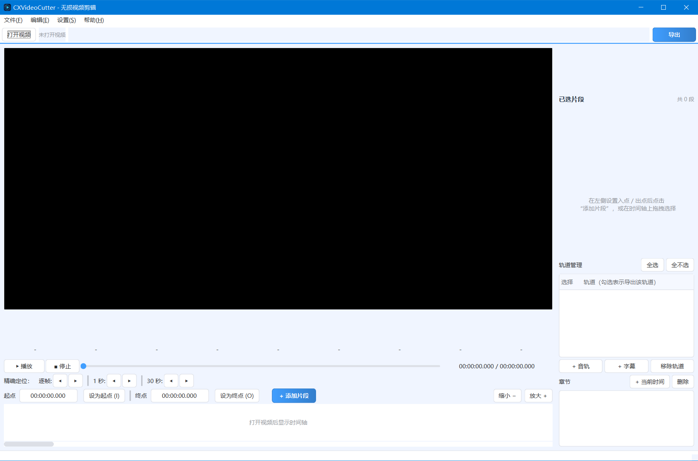
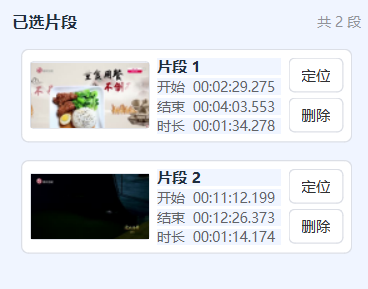
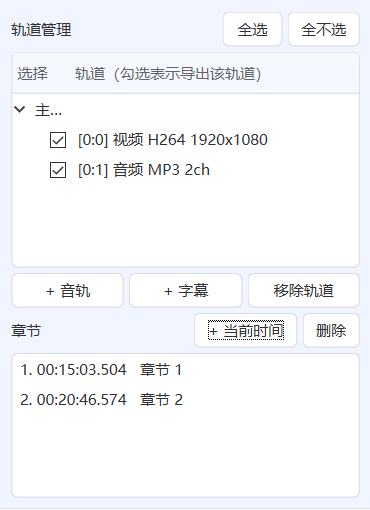
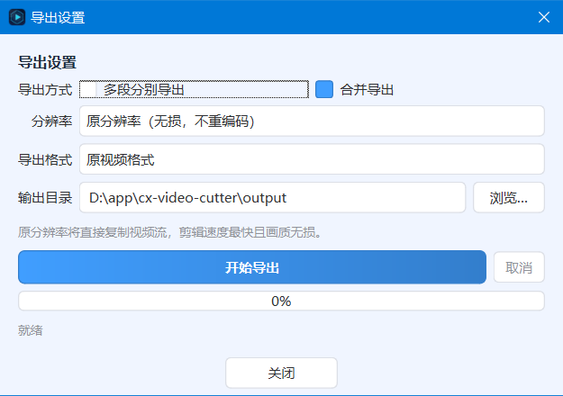
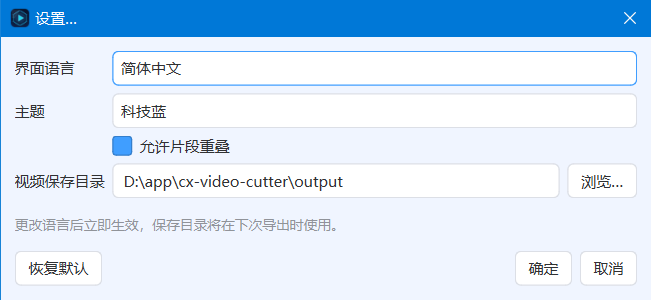

# CXVideoCutter

[](https://github.com/chenxu0818/CXVideoCutter/actions/workflows/build-macos.yml)
[](https://github.com/chenxu0818/CXVideoCutter/releases)

基于 FFmpeg 与 PySide6 的跨平台视频剪辑工具。主打多段无损剪辑与合并，支持视频、音频、字幕、章节轨道管理，以及多语言、多主题界面。发布版已内嵌精简 FFmpeg / FFprobe，无需单独安装。

> 原分辨率模式使用 `-c:v copy` 直接复制视频流，速度快且画质无损；剪切边界会受源视频关键帧影响。如需精确到帧，请选择 720p / 1080p / 4K 重编码模式（H.264，CRF 18）。

## 功能特性

- 多段选择：通过起点/终点按钮或时间轴拖拽选择多个片段，支持逐帧、1 秒、30 秒定位；时间轴拖拽选择最短 5 秒，避免双击误选。
- 帧预览条：根据窗口分辨率动态调整帧数量，批量抽帧 + 缓存，点击帧即可定位。
- 音量控制：预览播放支持音量调节与静音。
- 布局可调：视频预览区支持宽度和高度拖拽调整。
- 无损导出：原分辨率直接复制视频、音频、字幕流；不重编码，速度最快。
- 重编码导出：720p / 1080p / 4K 使用 libx264 重编码视频，音频保持复制。
- 导出方式：多段分别导出，或先分段处理再合并为一个文件。
- 容器格式：保持原视频格式，或指定 MKV / MP4。
- 轨道管理：展示主视频自带的视频、音频、字幕、附件轨道，可勾选是否参与导出；支持添加外部音轨/字幕。
- 章节管理：按时间点添加章节，导出为 FFmetadata；合并时会自动重映射章节时间。
- 多语言：简体中文、繁体中文、English，切换后立即生效。
- 多主题：默认深色、深空蓝、霓虹紫、极光绿、赛博橙、科技蓝、星空科技。
- 设置持久化：输出目录、语言、主题、是否允许片段重叠保存在本地 `settings.ini`。
- 日志：按天写入 `log/YYYY-MM-DD.log`，记录导出命令、FFmpeg 输出和错误，便于排查问题。
- 安全取消：导出过程中可取消，会终止 FFmpeg 进程树并清理临时文件。
- 日志管理：日志菜单按日期列出日志并查看内容，自动清理 30 天前的日志。
- 任务栏进度：Windows 下导出时在任务栏图标显示进度，失败/取消时自动恢复。

## 下载与安装

从 [Releases](https://github.com/chenxu0818/CXVideoCutter/releases) 下载对应平台产物：

| 平台 | 文件 | 说明 |
| --- | --- | --- |
| Windows x64 | `CXVideoCutter-win-x64.exe` | 适用于 64 位 Windows |
| Windows ARM64 | `CXVideoCutter-win-arm64.exe` | 适用于 ARM64 Windows 设备 |
| macOS Apple Silicon | `CXVideoCutter-macos-arm64.zip` | 解压得到 `CXVideoCutter.app` |

macOS 首次打开时，如被 Gatekeeper 拦截，可右键 `.app` 选择“打开”，或在“系统设置 → 隐私与安全性”中允许。发布包已做 ad-hoc 签名，面向他人分发时仍需按 Apple 要求公证。

## 快速开始

1. 打开 CXVideoCutter，点击右上角“导出”按钮旁的文件菜单或“打开视频…”。
2. 在预览区下方使用“逐帧 / 1 秒 / 30 秒”定位，或点击时间轴选择起止点。
3. 点击“设为起点 (I)”和“设为终点 (O)”，再点击“添加片段”；也可直接在时间轴上拖拽选择。
4. 在右侧检查片段列表、勾选需要导出的轨道，必要时添加章节或外部音轨/字幕。
5. 打开“导出设置”，选择导出方式、分辨率、格式和输出目录，点击“开始导出”。

## 功能说明

### 选段与时间轴

- 时间轴支持单击定位、拖拽选择片段（至少 5 秒）、`Ctrl + 滚轮` 缩放。
- 右侧“已选片段”显示首帧缩略图、起止时间、时长，可重新定位或删除。
- 设置中可关闭“允许片段重叠”，避免重复或交叠添加同一时间段。

### 轨道与章节

- 主视频自带轨道不可物理移除，只能取消勾选；取消勾选后不会参与导出。
- 外部音轨/字幕以追加输入方式与主视频一起导出。
- 章节按时间点管理，增删后自动重编号为“章节 1 / 章节 2 …”；同一时间点只允许一个章节。

### 导出

- 原分辨率：视频流直接复制，画质无损；字幕在 MP4 中转为 `mov_text`，其他容器保持复制。
- 重编码分辨率：视频使用 `libx264 -preset medium -crf 18 -pix_fmt yuv420p`，音频保持复制。
- 合并导出会先生成各片段临时文件，再用 concat 清单合并，并写入重映射后的章节。
- 导出期间设置项会被锁定，避免任务执行中参数被修改。

### 设置

- 视频保存目录：Windows 默认在程序目录 `output`，macOS 默认在 `~/Movies/CXVideoCutter`。
- 界面语言：简中 / 繁中 / English。
- 主题：7 套配色，其中“科技蓝”参考 Element Plus 主色板设计。
- 允许片段重叠：默认开启；关闭后新增片段不能与已有片段交叠。

## 界面截图

主界面：预览区、时间轴、帧预览条与右侧面板。



多段选择：已选片段展示首帧缩略图、起止时间与时长。



轨道管理与章节：可勾选参与导出的轨道，并按时间点管理章节。



导出设置：导出方式、分辨率、格式与输出目录。



设置：界面语言、主题、片段重叠策略与输出目录。



## 从源码运行

需要 Python 3.10 或更高版本。

```bash
python -m pip install -r requirements.txt
```

将 `ffmpeg` / `ffprobe` 加入 `PATH`，或放到项目可识别目录（打包后也可放在 EXE 同目录），然后运行：

```bash
python main.py
```

源码模式下配置与日志写入项目根目录：`settings.ini`、`log/`。

## 构建

CI 会在推送到 `main` 时自动构建三个平台并发布 Release，配置见 `.github/workflows/build-macos.yml`。

本地构建：

- Windows x64：参考工作流中的 PyInstaller 命令，依赖 `build_tools/ffmpeg-install/bin/` 下的 FFmpeg。
- Windows ARM64：运行 `build_tools/arm64/prepare_assets.py` 与 `build_tools/arm64/build_arm64_exe.py`。
- macOS Apple Silicon：运行 `bash build_tools/macos/build_macos_app.sh`，脚本会自动准备 Python 3.10+ 虚拟环境、下载 arm64 FFmpeg 并生成 `.app`。

## 项目结构

```text
CXVideoCutter/
├── main.py                     # 程序入口
├── app/
│   ├── core/                   # 数据模型、FFmpeg 封装、导出、配置、i18n、主题、日志
│   ├── ui/                     # 主窗口、时间轴、帧预览、轨道、导出、设置等界面
│   └── resources/              # 应用图标
├── build_tools/                # FFmpeg 构建脚本、Windows x64/ARM64 与 macOS 打包脚本
├── docs/images/                # README 界面截图
├── .github/workflows/          # 三平台构建与 Release 工作流
├── LICENSE                     # GPL-3.0-or-later 许可证全文
├── THIRD_PARTY_NOTICES.md      # 第三方二进制许可说明
└── README.md
```

## 许可与第三方组件

本项目采用 [GPL-3.0-or-later](LICENSE) 许可证。源码中附带的 FFmpeg / x264 预编译二进制以 GPLv3 兼容方式编译，分发时请遵守 [THIRD_PARTY_NOTICES.md](THIRD_PARTY_NOTICES.md) 中的要求。

本项目使用的主要第三方组件：

- [FFmpeg](https://ffmpeg.org/) — 音视频处理核心
- [PySide6 / Qt](https://doc.qt.io/qtforpython/) — 图形界面
- [PyInstaller](https://pyinstaller.org/) — 单文件打包

## 贡献

欢迎通过 Issue 反馈问题或提交 PR。提交前请确保代码在对应平台可运行，并尽量附上复现步骤或日志。
